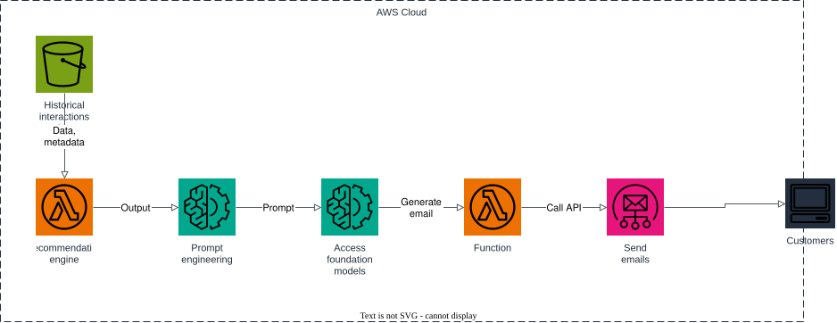

# AWS Project: Personalized Marketing

This architecture uses generative AI to personalize marketing outreach based on each individual consumer's preferences and interaction history.

1. historical interaction data (browsing, purchases, cart activity) is stored as objects in S3;
2. a scheduled `recommendation-engine` Lambda reads the data and metadata for every customer and works out the category they're currently most interested in;
3. that output is turned into a generation prompt (prompt engineering) describing the customer and their recommended category;
4. the prompt is sent to a Bedrock foundation model, which generates a personalized marketing email (subject + body);
5. the `function` step hands the generated email off by calling the `send-emails` Lambda API;
6. `send-emails` calls SES to deliver the message to the customer.

## Prerequisites

- Docker
- Terraform 1.5+
- AWS CLI

## Start Floci

```bash
docker compose up -d
```

## Apply Terraform

```bash
terraform init
terraform apply
```

Applying:

- creates the `customer-data` S3 bucket and uploads sample [historical_interactions.json](src/data/historical_interactions.json) and [customers.json](src/data/customers.json);
- verifies the SES sender identity (`ses_sender_email`);
- deploys the `send-emails` Lambda, which calls `ses.send_email`;
- deploys the `recommendation-engine` Lambda, which reads S3 data, builds a prompt per customer, calls `bedrock-runtime.invoke_model`, and invokes `send-emails` for each generated campaign;
- schedules the `recommendation-engine` to run on `schedule_expression` (default: once a day) through an EventBridge rule.

## Architecture



The diagram source is a real, editable [draw.io](https://www.drawio.com/) file at [docs/architecture.drawio](docs/architecture.drawio), generated programmatically with the [drawpyo](https://github.com/MerrimanInd/drawpyo) Python library. Open the `.drawio` file directly on GitHub or with the draw.io desktop app / [app.diagrams.net](https://app.diagrams.net/) to edit it.

To regenerate the diagram (`.drawio` source + the `.svg`/`.png` embedded above) after changing the architecture:

```bash
python3 -m venv .diagram-venv
.diagram-venv/bin/pip install drawpyo
.diagram-venv/bin/python scripts/generate_diagram.py

# rasterize the .drawio file to svg/png (used by the README) via headless draw.io
docker run --rm -v "$PWD/docs":/data -w /data rlespinasse/drawio-export -f svg -o . --output-mode relative --remove-page-suffix .
docker run --rm -v "$PWD/docs":/data -w /data rlespinasse/drawio-export -f png -o . --output-mode relative --remove-page-suffix -t .
```

## Trigger a campaign run manually

```bash
FUNCTION_NAME=$(terraform output -raw recommendation_engine_function_name)

aws --endpoint-url http://localhost:4566 lambda invoke \
  --function-name "$FUNCTION_NAME" --payload '{}' /tmp/campaign-result.json
cat /tmp/campaign-result.json
```

## Inspect the campaign data

```bash
BUCKET=$(terraform output -raw customer_data_bucket)

aws --endpoint-url http://localhost:4566 s3 cp "s3://$BUCKET/customers.json" -
aws --endpoint-url http://localhost:4566 s3 cp "s3://$BUCKET/historical_interactions.json" -
```

If you want to follow the execution, watch the Floci container logs:

```bash
docker compose logs -f floci
```

## Clean up

```bash
terraform destroy
docker compose down
```
